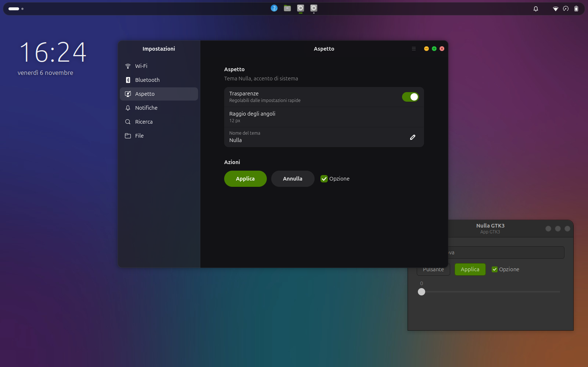
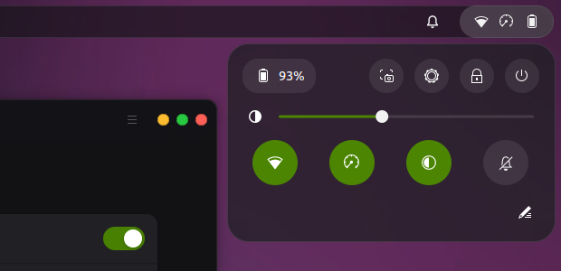
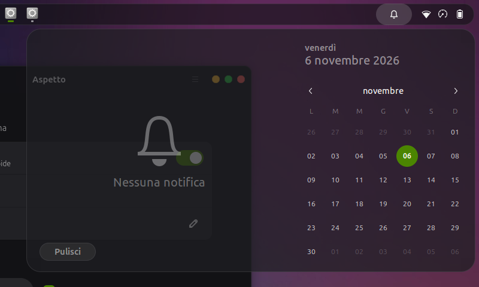
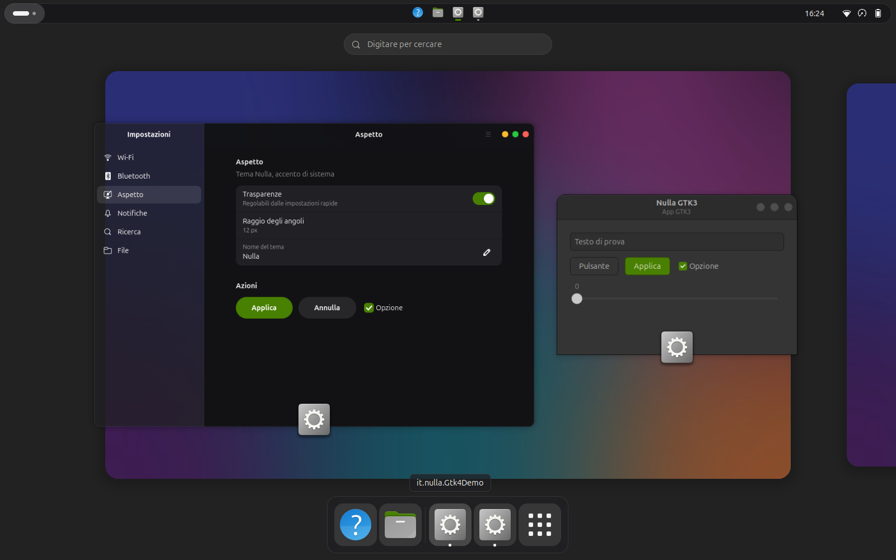
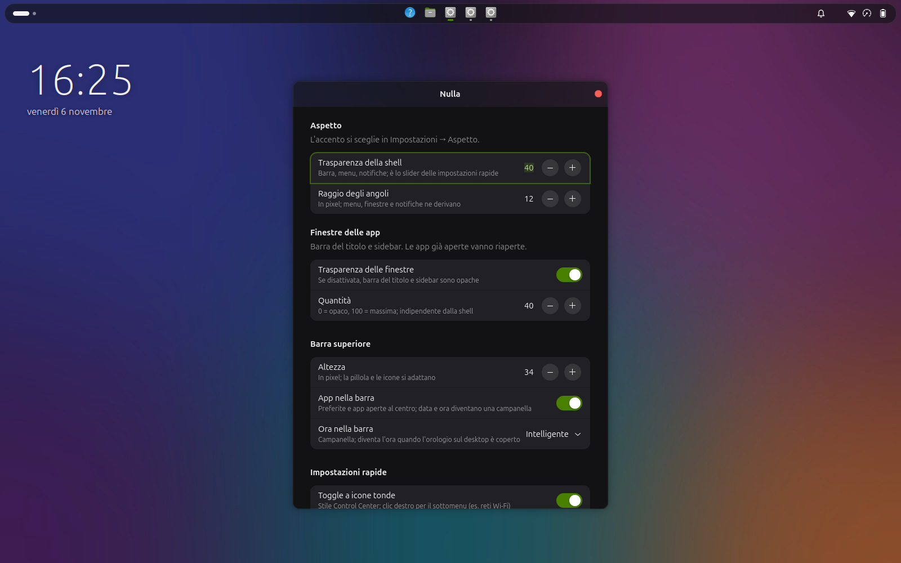
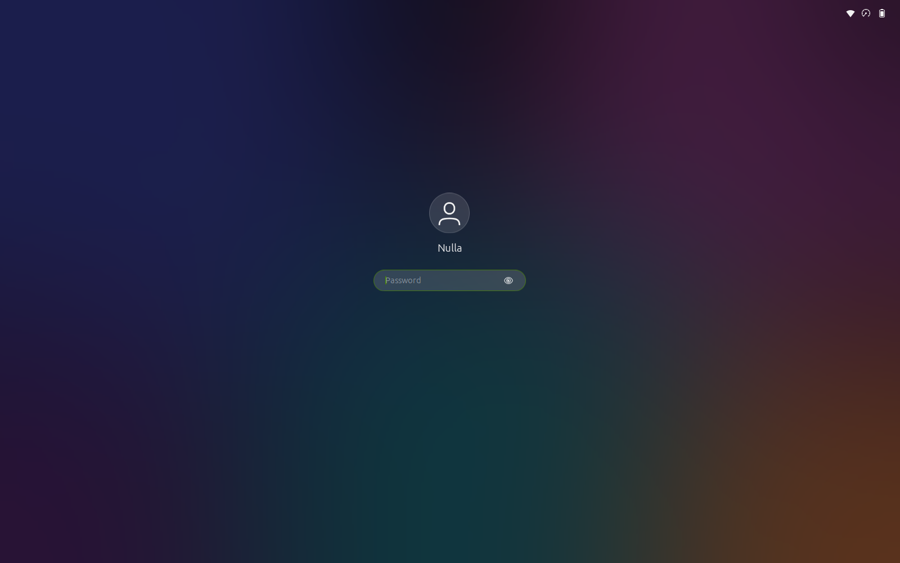

# Nulla

**A minimal dark theme for GNOME Shell and GTK apps**: glass surfaces with adjustable
transparency, GNOME's native accent color, macOS-style window buttons and a floating
pill-shaped top bar that replaces the dock.



> Built and tested on **Ubuntu 26.04 / GNOME 50 (Wayland)** on top of the default Yaru
> theme. The extension declares GNOME 48–50. The preferences window and the shell
> labels it adds are currently in Italian.

## Features

- **Adjustable transparency**: a slider in Quick Settings (under brightness) changes
  how much glass the shell shows. App windows get their own separate amount and on/off
  switch: only title bars and sidebars become translucent, the content stays opaque.
- **Native accent**: pick it in *Settings → Appearance* and the shell, GTK apps and
  VS Code follow it.
- **macOS-style window buttons** on the right, in the order − + ×: clean
  yellow/green/red dots. Hover the group and the symbols appear; the button under the
  pointer lights up. When the window is not focused the dots turn grey.
- **Floating pill top bar** with adjustable height: workspaces on the left, favorite and
  running apps in the middle (the dock is turned off), status icons, a notification bell
  and Quick Settings on the right. Apps in the bar can be reordered by dragging.
- **Control Center-style Quick Settings**: round icon-only toggles. Right-click a
  toggle for its menu (e.g. Wi-Fi networks). The pencil button enters an edit mode, as
  on Android: tap to hide or show a toggle, drag to reorder.
- **Essential calendar and notifications**: no events, weather or world clocks;
  notifications are glass cards; the bell gets an accent dot when there is something
  new. If the desktop clock is hidden, the bell can show the time instead.
- **Desktop clock**: 9 positions and 8 styles (Classic, Thin, Bold, Stacked, Accent,
  Elegant, Pill, Analog). Its text turns dark or light depending on the wallpaper
  under it.
- **Lock screen and login screen** in the same style: blurred wallpaper, the same
  clock, a small avatar and a pill-shaped password field.
- **VS Code and Chrome** (optional, one switch each): VS Code gets a "Nulla" color theme
  that follows the accent and uses the GNOME title bar; Chrome switches to its GTK
  theme. Either way the window buttons match the rest of the desktop.
- **Blur my Shell** integration: blur behind the bar and menus, with corner
  radii that match the theme.

| Quick Settings | Calendar and notifications |
|---|---|
|  |  |

| Overview | Preferences |
|---|---|
|  |  |



## Requirements

- GNOME Shell 48–50 on Wayland, Ubuntu with the Yaru theme (other distributions are
  untested; the login screen theme requires Yaru).
- `gjs`, `python3`, `glib-compile-schemas`, `dconf` (all present on a standard Ubuntu
  desktop). The login screen theme also needs ImageMagick (`magick`).
- Optional: [Blur my Shell](https://extensions.gnome.org/extension/3193/blur-my-shell/)
  for the blur. Without it the theme works, just without blur.

## Installation

```bash
git clone https://github.com/umas97/nullaTheme.git
cd nullaTheme
./install.sh
```

Then **log out and back in**: on Wayland that is the only way GNOME Shell loads a new
extension. GTK apps pick up the theme the next time they are opened.

The script runs as your user (no root) and, the first time, saves your current settings
to `~/.local/share/nulla/backup-originale/`; reinstalling never overwrites that backup.
What it changes:

- copies the extension to `~/.local/share/gnome-shell/extensions/nulla@umas97`;
- adds `@import url("nulla.css");` to `~/.config/gtk-3.0/gtk.css` and `~/.config/gtk-4.0/gtk.css`;
- sets the dark color scheme and the window button layout `:minimize,maximize,close`;
- configures Blur my Shell (no tint of its own) and turns off Dash to Dock / Ubuntu Dock.

### Login screen (optional)

The login screen is drawn by GDM, which does not load extensions, so it is installed
separately. Run it as your normal user; it asks for the administrator password only to
copy the theme into place:

```bash
tools/gdm/install-gdm.sh     # build and activate the "Nulla" GDM theme
tools/gdm/uninstall-gdm.sh   # go back to Ubuntu's login screen
```

The theme starts from Yaru's and embeds your accent and a blurred copy of your wallpaper
(GDM cannot read your home folder), so run it again after changing either, or after a
Yaru update. Ubuntu's theme is left untouched: Nulla is added as a higher-priority
alternative with `update-alternatives`. If anything goes wrong, switch to a text console
(Ctrl+Alt+F3), log in and run `sudo update-alternatives --auto gdm-theme.gresource`.

## Usage

| What | Where |
|---|---|
| Shell transparency | Quick Settings (top right) → ◐ slider |
| App window transparency | *Extensions* → Nulla → ⚙ → *Finestre delle app* |
| Accent color | Settings → Appearance |
| Corner radius, bar height, clock style and position, every feature on/off | *Extensions* → Nulla → ⚙ |
| VS Code / Chrome theming | *Extensions* → Nulla → ⚙ → *Integrazioni* |
| Apps in the bar | click = open / focus / minimize · middle click = new window · right click = menu · drag = reorder (drag from the app grid to add) |
| Quick Settings toggles | right click = toggle menu · ✎ = edit mode |

### VS Code and Chrome

Both switches are on by default and are applied by the extension at login. Turning one
off puts back the settings that were there before.

- **VS Code** sets `workbench.colorTheme`, `window.titleBarStyle: native` (the window
  buttons are drawn by GNOME, since VS Code's own buttons cannot be restyled) and
  `window.menuStyle: custom` (menu and search share one bar). Restart VS Code to see it.
  If `settings.json` contains comments it is left alone.
- **Chrome** is switched to its GTK theme. Chrome rewrites its preferences when it
  quits, so the change waits until Chrome is closed. If Chrome Sync brings back a
  colored theme, the extension applies GTK again at the next login; you can also pick
  it yourself in *Settings → Appearance → Theme: GTK*.

## Uninstall

```bash
./uninstall.sh
```

Removes the extension and the GTK files, puts back VS Code's and Chrome's previous
settings, and restores the backup taken at install time (dock, Blur my Shell, button
layout, color scheme). Log out and back in to finish.

## How it works

- **Shell**: the extension adds the `nulla` class to the shell UI and loads
  `shell.css.in`, compiled with the current settings. Its rules win over Yaru without
  replacing it, so disabling the extension instantly brings back the system theme.
- **GTK 4 / libadwaita**: `gtk.css` imports `nulla.css`, which redefines libadwaita's
  color variables. The window background is translucent, while the content
  (`toolbarview > :first-child`, `.content-pane`) has its own nearly opaque background,
  so only title bars and sidebars let the wallpaper through.
- **GTK 3**: only the window buttons change; colors stay Yaru's, which follows the
  system accent anyway.
- **Transparency**: every surface has a weight `k` in `tokens.js`; with the slider at
  `t`, its opacity is `1 − k·t`. Changing the weights changes the character of the
  whole theme.

```
extension/nulla@umas97/
├── extension.js      entry point: shell CSS, slider, Blur my Shell, apps, features
├── tokens.js         settings → CSS values (transparency weights, radii, sizes)
├── files.js          writes the GTK CSS and the VS Code theme (also used by tools/)
├── apps.py           applies / restores VS Code and Chrome settings
├── quickToggles.js   round icon-only Quick Settings toggles
├── toggleEditor.js   toggle edit mode (hide, show, reorder)
├── panelLayout.js    apps in the top bar, bell, essential calendar
├── barClock.js       bell that turns into the time when the desktop clock is hidden
├── clockFace.js      clock styles, shared by the desktop and the lock screen
├── desktopClock.js   desktop clock with adaptive color
├── lockScreen.js     Nulla clock on the lock screen
├── prefs.js          preferences window
├── schemas/          settings
└── theme/
    ├── shell.css.in  GNOME Shell (on top of Yaru, every rule scoped to .nulla)
    ├── auth.css.in   lock and login screen (shared with GDM)
    ├── gdm.css.in    login screen only
    ├── gtk4.css.in   GTK 4 / libadwaita
    ├── gtk3.css.in   GTK 3 window buttons
    ├── vscode/       VS Code color theme template
    └── assets/       × − + symbols for the window buttons
tools/
├── common.sh         shared shell helpers
├── render-gtk.js     generates the GTK CSS outside the shell (used by install.sh)
├── render-template.js compiles a CSS template with the current settings
├── gdm/              login screen theme (build, install, uninstall)
├── preview.sh        headless preview with screenshots, see below
└── preview/          demo windows and the test extension used by preview.sh
```

### Preview without logging out

```bash
tools/preview.sh [output-dir]                                   # default: ./preview
NULLA_PREVIEW_WALLPAPER=docs/wallpaper.jpg tools/preview.sh     # neutral wallpaper
```

Starts a **headless** GNOME Shell with its own HOME, D-Bus and dconf, installs Nulla
there with `install.sh`, opens a GTK 4 and a GTK 3 demo window and saves screenshots of
the desktop, Quick Settings, calendar, overview, preferences and lock screen. Useful to
try CSS changes without logging out; the screenshots in this README come from it.

## Known limitations

- **Already open apps**: GTK reads CSS only at startup, so the slider changes the shell
  immediately but apps only when reopened.
- **No blur behind windows**: GNOME does not support it, so app transparency is a plain
  tint.
- **Flatpak apps** don't read `~/.config/gtk-4.0` until you allow it:
  `flatpak override --user --filesystem=xdg-config/gtk-4.0:ro --filesystem=xdg-config/gtk-3.0:ro`
- **Other Snap and Electron apps** draw their own windows and are not themed (VS Code
  and Chrome are handled as described above).
- **Apps in the bar**: dragging a running app that isn't a favorite adds it to the
  favorites (as in the dock); remove it with right click → *Rimuovi dai preferiti*.
- **Desktop clock**: its color adapts to the wallpaper, not to windows, and it shows
  through the translucent parts of apps. With slideshow wallpapers (`.xml`) it stays light.

## License

[GPL-3.0](LICENSE). The login screen theme is built from Ubuntu's Yaru theme at install
time; no Yaru files are included in this repository.
